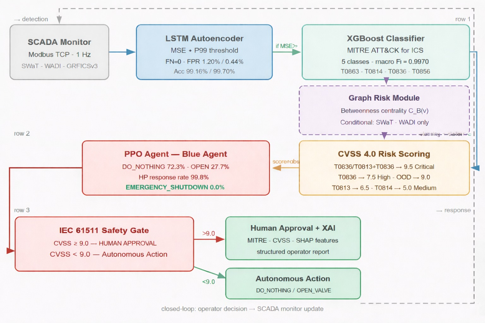

# GRAD-RL: Autonomous Cyber-Physical Defense for Industrial Control Systems

[](https://doi.org/10.5281/zenodo.20433521)
[](LICENSE)


Code, trained models and evaluation logs for the paper
**"GRAD-RL: Autonomous Cyber-Physical Defense for Industrial Control Systems via Graph-Augmented Hybrid AI and MITRE ATT&CK-Aligned Threat Classification"** (submitted to IEEE Access).

GRAD-RL is an end-to-end defense pipeline for industrial control systems. It detects anomalies in process data, names the attack technique in MITRE ATT&CK for ICS terms, scores its risk from the safety impact and the position of the targeted asset in the plant network, and recommends a response through a reinforcement learning agent. A human-in-the-loop safety gate aligned with IEC 62443 holds every high-risk or irreversible action for operator approval, and every decision comes with a plain-language explanation.



## Pipeline

| Stage | What it does | Code |
|---|---|---|
| I–II Detection | LSTM autoencoder trained on normal data only; anomaly if the reconstruction error exceeds the P99 threshold of the normal training windows; culprit sensor = largest per-sensor error | `scripts/*/train_detector.py` |
| III Technique | XGBoost classifier with MITRE ATT&CK for ICS technique IDs as class labels | `scripts/*/train_detector.py` |
| IV Risk | CVSS 4.0-style impact with safety weight 1.5, amplified by the normalized betweenness centrality of the targeted asset, capped at 10 | `gradrl/topology_manager.py`, `configs/` |
| V Response | **Mode 2** (GRFICSv3): PPO agent on the 13 scaled sensor values. **Mode 1** (SWaT): deterministic CVSS-to-action mapping | `scripts/grfics/train_ppo.py`, `gradrl/grfics_env.py` |
| Gate | Human approval if severity ≥ θ_g or the action is `EMERGENCY_SHUTDOWN`; θ_g = 9.0 for SWaT, 7.0 in the GRFICSv3 live deployment | `deployment/*/api_defensive.py` |

In the reported experiments GRAD-RL runs as a **decision-support layer**: actions are recommended and logged, never written back to a PLC.

## Repository layout

```
gradrl/                  shared library code
  paths.py               repository-relative paths (data, models, configs, results)
  data_loader.py         SWaT / WADI loading and preprocessing
  data_loader_grfics.py  GRFICSv3 loading, MITRE label engineering
  topology_manager.py    asset graph, betweenness centrality, risk score, tag mapping
  grfics_env.py          replay-based Gymnasium environment for the GRFICSv3 PPO agent
  scada_env.py           exploratory abstract SWaT environment (not used for the paper results)
configs/                 SWaT topology graph (15 nodes, 30 edges) and mitigation knowledge base
scripts/
  grfics/                train detector, train PPO, PPO vs. baselines, latency benchmark
  swat_wadi/             train detector, SWaT live streaming, safety-weight sensitivity, WADI retraining and sweep
deployment/
  grfics_live/           FastAPI detective (port 8000) and defensive (port 8001) services, Modbus bridge
  swat_wadi/             dataset-agnostic services used for SWaT and WADI
  dashboards/            Streamlit operator dashboards (GRFICSv3 live, SWaT, multi-dataset)
models/                  trained detectors, classifiers, scalers, thresholds and PPO agents
results/                 the numbers reported in the paper, by dataset
experiments/             exploratory pipelines on other datasets (HAI, MSU gas, MSU power); not part of the paper
docs/                    figures
```

## Installation

```bash
git clone https://github.com/veyselalevcan/GRAD-RL-Autonomous-Cyber-Physical-Defense-for-ICS.git
cd GRAD-RL-Autonomous-Cyber-Physical-Defense-for-ICS
python -m venv .venv
pip install -r requirements.txt
```

## Data

The datasets are not redistributed here. Put them in `data/` or point `GRADRL_DATA_DIR` at the folder that contains them.

| File | Source |
|---|---|
| `grad_rl_final_dataset.csv` | GRFICSv3 MITRE-annotated dataset (90,728 samples), [Zenodo 10.5281/zenodo.20433521](https://doi.org/10.5281/zenodo.20433521) |
| `SWaT_Dataset_Normal_v1.csv`, `SWaT_Dataset_Attack_v0.csv` | iTrust, SUTD (access on request) |
| `WADI_14days_new.csv`, `WADI_attackdataLABLE.csv` | iTrust, SUTD (access on request) |

```bash
export GRADRL_DATA_DIR=/path/to/data      # PowerShell: $env:GRADRL_DATA_DIR="D:\data"
```

## Reproducing the paper

Run every script from the repository root; outputs go to `results/<dataset>/`. The models in `models/` are the ones behind the paper, and retraining overwrites them.

| Paper item | Command | Output |
|---|---|---|
| GRFICSv3 detection and classification (Figs. 2–4, Table 7) | `python scripts/grfics/train_detector.py` | `results/grfics/rf_classification_report_grfics_live.csv` |
| GRFICSv3 PPO training and evaluation (Fig. 5) | `python scripts/grfics/train_ppo.py` | `results/grfics/rl_evaluation_report.txt` |
| PPO vs. baseline policies (Table 8) | `python scripts/grfics/ppo_vs_baselines.py` | `results/grfics/ppo_vs_baselines.json` |
| PPO outlier episode (Section VI-A) | `python scripts/grfics/ppo_outlier_episode.py` | console |
| Inference latency (Table 11) | `python scripts/grfics/latency_benchmark.py` | `results/grfics/latency_report.txt` |
| SWaT and WADI detection and classification | `python scripts/swat_wadi/train_detector.py` (set `DATASET_TO_TRAIN`) | `results/swat/`, `results/wadi/` |
| SWaT live streaming (Section VI-C) | `python scripts/swat_wadi/swat_live_stream.py` | `results/swat/telemetry_audit_swat*.csv` |
| Safety-weight sensitivity (Table 3) | `python scripts/swat_wadi/ws_sensitivity.py` | console |
| WADI extended-patience model and threshold sweep (Table 10) | `python scripts/swat_wadi/wadi_retrain.py`, then `python scripts/swat_wadi/wadi_sweep.py` | `results/wadi/wadi_threshold_sweep.txt` |

`results/grfics_live/` holds the record of the 1 h 51 min live session on the GRFICSv3 digital twin: the audit log (`telemetry_audit.csv`, 10,352 observations), the XAI report of every anomalous event (`xai_incidents.json`, one JSON object per line) and the attack schedule (`experiment_journal.txt`).

The SWaT full-campaign evaluation (36 attacks, Section VI-G) uses a second implementation of the pipeline that is not part of this repository.

## Live deployment on GRFICSv3

Requires a running [GRFICSv3](https://github.com/Fortiphyd/GRFICSv3) instance whose PLC is reachable over Modbus TCP. Set `PLC_IP` and `PLC_PORT` in `deployment/grfics_live/live_bridge.py`, then start the services below. The detector service is configured exactly as in the recorded live session: it flags an anomaly when the reconstruction error exceeds a fixed operating threshold of 0.5 (`api_detective.py`), not the offline P99 threshold in `models/threshold_grfics_live.json`.

```bash
uvicorn deployment.grfics_live.api_detective:app --port 8000
uvicorn deployment.grfics_live.api_defensive:app --port 8001
python deployment/grfics_live/live_bridge.py                 # polls the PLC at 1 Hz
streamlit run deployment/dashboards/dashboard_grfics_live.py  # operator view; logs to results/grfics_live/new_session/
```

## Results summary

| Dataset | LSTM-AE accuracy | FPR | FN | XGBoost macro F1 |
|---|---|---|---|---|
| GRFICSv3 | 99.70 % | 0.44 % | 0 | 0.997 |
| SWaT | 99.16 % | 1.20 % | 0 | 0.889 |
| WADI | 74.17 % | 24.3 % | 3,338 | 0.625 |

WADI is a boundary case: the false-positive rate stays near 23 % for every threshold, because the normal training period does not cover the operating states of the attack period.

| GRFICSv3 response policy (50 episodes) | Return | High-pressure response |
|---|---|---|
| PPO (GRAD-RL) | 229.5 ± 334.5 | 99.8 % |
| Threshold rule (valve if p ≥ 0.90) | 4.9 ± 293.1 | 0.0 % |
| Never act | 37.2 ± 295.1 | 0.0 % |

End-to-end latency is 149 ± 38 ms per decision on a CPU-only laptop (Intel Core i7-6600U), well inside the 1 s Modbus polling cycle.

## Known limitations

- On GRFICSv3, each technique was recorded as one attack episode, the classifier is trained and tested on parts of that episode, and XGBoost early stopping monitors the test split. The macro F1 therefore measures recognition within known scenarios.
- The technique classifier is closed-set: unseen techniques are detected as anomalies but reported under the nearest training class.
- In SWaT, 129 of 503 Attack6 samples are classified as Attack4, which has a lower severity.
- The topology-weighted risk score does not drive the reported SWaT decisions; Mode 1 uses the technique-level CVSS mapping.

The paper lists all limitations.

## Citation

See [`CITATION.cff`](CITATION.cff). The paper reference will be added after publication.

## License

MIT, see [LICENSE](LICENSE). The SWaT and WADI datasets are subject to the iTrust terms of use.
